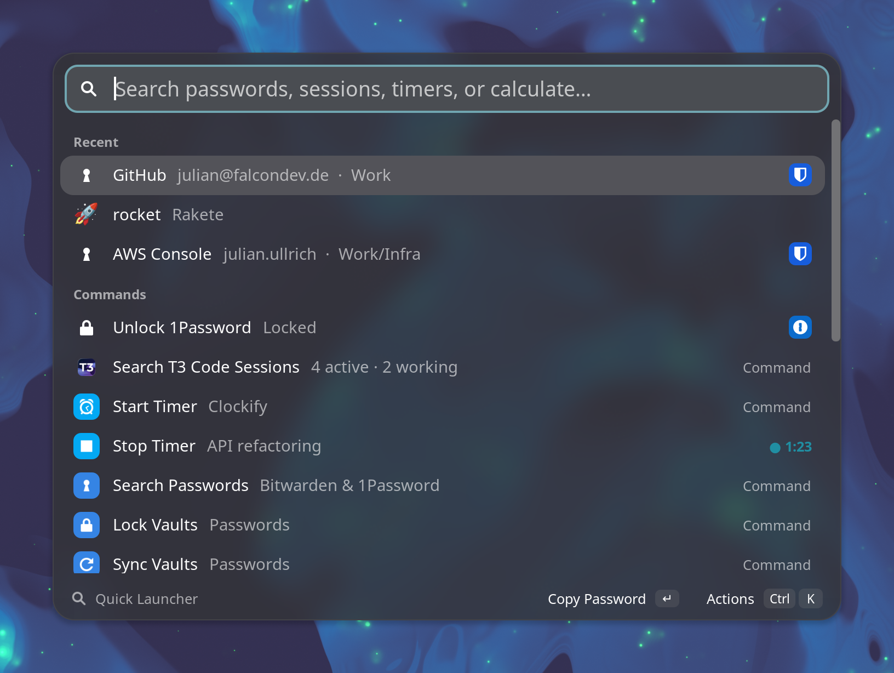
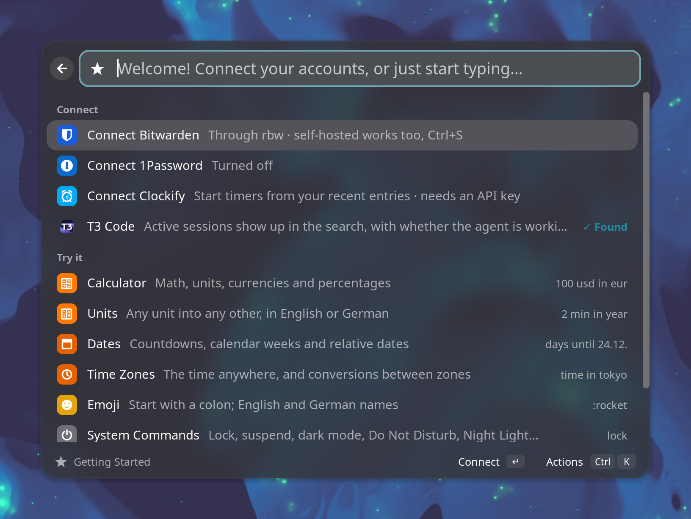
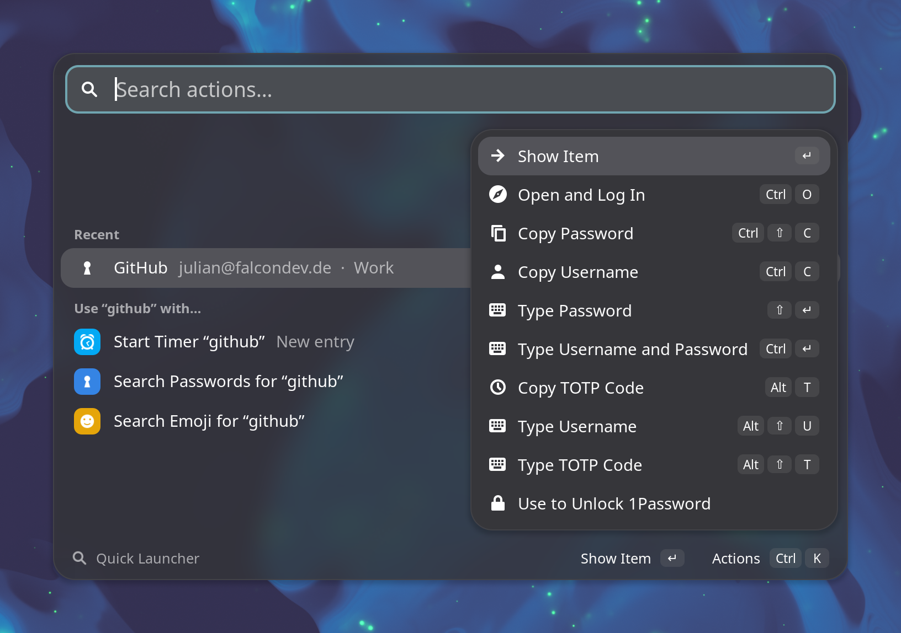
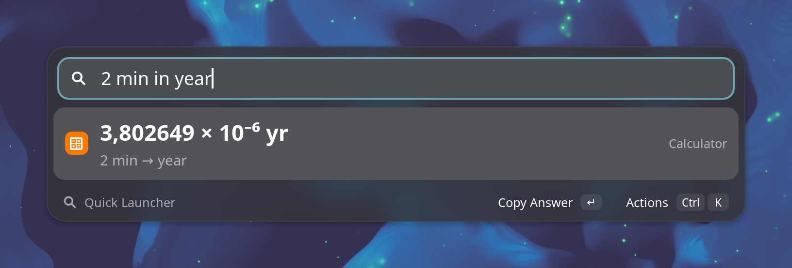
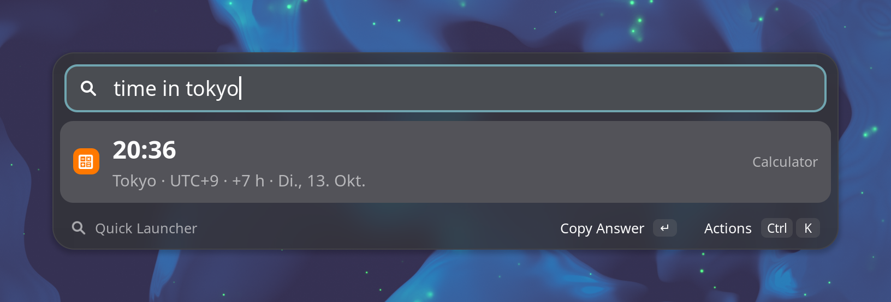
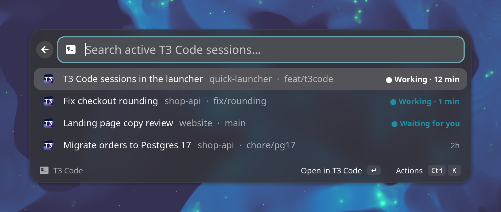
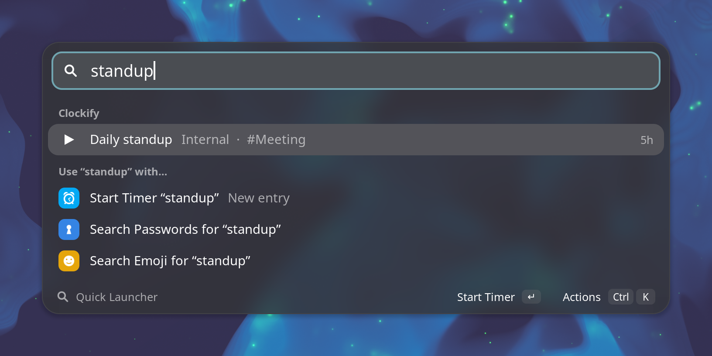
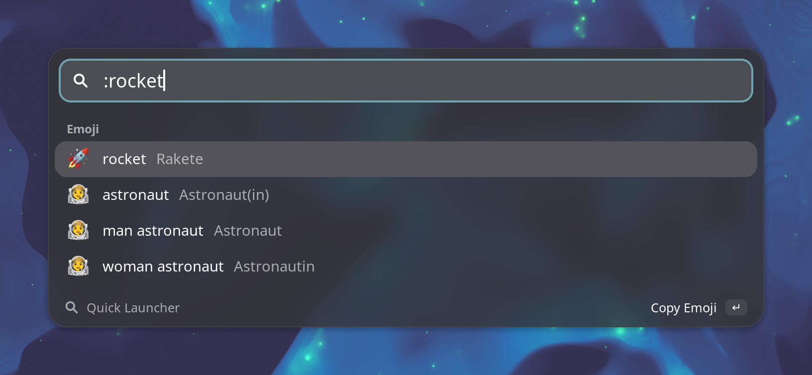

# Quick Launcher

A Raycast-style launcher for GNOME Shell: your passwords, your T3 Code sessions, your Clockify
timer, a calculator, emoji and system commands behind one shortcut.

Press <kbd>Ctrl</kbd><kbd>Shift</kbd><kbd>Enter</kbd> and start typing. One search covers
**Bitwarden** and **1Password**, active **T3 Code** sessions, recent Clockify entries and every
command, and anything that looks
like math, a unit conversion, a date or a time zone is answered right away.

<p align="center">
  
</p>

## Features

- One search over Bitwarden (via [rbw](https://github.com/doy/rbw)) and 1Password (via the
  [`op` CLI](https://developer.1password.com/docs/cli/)), each entry tagged with its vault's logo
- Unlock either vault in the launcher: type the master password there, or hand over to the
  1Password app
- Items stay searchable while their vault is locked; using one asks to unlock it first
- Open an item's website and log in through the Bitwarden or 1Password browser extension
- Copy or type passwords, usernames and TOTP codes. Typing works on Wayland without ydotool
- Generate passwords and PINs; type a number to set the length
- Find active T3 Code sessions, see which are working and for how long, and open them in T3 Code
- Start and stop Clockify timers from your recent entries, or a new one with `@project` and `#tag`
- Calculator with units, currencies, percentages, dates, calendar weeks and time zones
- Emoji search in English and German
- System commands: lock, suspend, log out, restart, power off, screenshot, dark mode, Do Not
  Disturb, Night Light
- Follows the shell theme (light, dark, accent color), with a blurred, translucent background
- Shows the running Clockify timer and how long it runs in the top bar
- *Getting Started* on the first open connects your accounts and shows what it can do

Quick Launcher supports GNOME Shell 48, 49 and 50.

## Install

Download the zip from the [latest release](https://github.com/TheSalaty/quick-launcher/releases/latest),
then run:

```sh
cd ~/Downloads
```

Then run:

```sh
gnome-extensions install --force quick-launcher@julian.falcondev.de.shell-extension.zip
```

Log out and back in, then enable the extension:

```sh
gnome-extensions enable quick-launcher@julian.falcondev.de
```

On Arch and Manjaro, [`packaging/PKGBUILD`](packaging/PKGBUILD) builds a system-wide package.

### From source

Requires Node.js 22 or newer and pnpm.

```sh
git clone https://github.com/TheSalaty/quick-launcher.git
cd quick-launcher
pnpm install
make install
```

Log out and back in before enabling the extension. Run `make pack` to build an installable zip.

## Getting started

After you enable the extension, a notification points you to the shortcut. The first time you
open the launcher, it starts with *Getting Started*:

- **Connect Bitwarden** asks for your account email and server, if rbw doesn't know them yet,
  and then your master password, all in the launcher. Leave the server empty for bitwarden.com,
  or enter your self-hosted server (Vaultwarden works too) or `vault.bitwarden.eu`.
  <kbd>Ctrl</kbd><kbd>S</kbd> switches to another server later.
- **Connect 1Password** unlocks it through the 1Password app or your master password.
- **Connect Clockify** takes an API key and checks it before saving it. <kbd>Ctrl</kbd><kbd>O</kbd>
  opens the page where you create one.
- T3 Code shows up as found if it is installed.
- **Try it** has examples for the calculator, dates, time zones, emoji and system commands. Press
  <kbd>Enter</kbd> on one to see it run.

<p align="center">
  
</p>

If a CLI isn't installed, its row links to the install guide instead. <kbd>Ctrl</kbd><kbd>D</kbd>
turns off a password manager you don't use. You can also just start typing, which searches as
usual. *Getting Started* stays available as a command.

## Using it

When the launcher opens, your recently used passwords, entries and emoji are listed first, then
all commands. Typing searches everything at once and groups the results: a calculator answer on
top, then passwords, Clockify entries and commands. Only items matching every word you typed are
shown. Below them, *Use “…” with* starts a timer with the text or searches passwords or emoji
for it.

The launcher uses the shell theme, so it follows light and dark style and your accent color. Its
background is translucent and blurs what is behind it; the rest of the desktop stays as it is.

<p align="center">
  
</p>

| Key | Action |
| --- | --- |
| <kbd>Ctrl</kbd><kbd>Shift</kbd><kbd>Enter</kbd> | open or close the launcher |
| <kbd>Enter</kbd> | run the selected item's main action (shown at the bottom right) |
| <kbd>Ctrl</kbd><kbd>K</kbd> | show all actions for the selected item |
| <kbd>↑</kbd> <kbd>↓</kbd> / <kbd>Tab</kbd> / <kbd>Ctrl</kbd><kbd>N</kbd> <kbd>Ctrl</kbd><kbd>P</kbd> | move the selection |
| <kbd>Esc</kbd> | go back, or close |
| <kbd>Backspace</kbd> on an empty field | go back |

These are the defaults. Every shortcut, in the launcher and for every action, can be changed on
the *Shortcuts* page of the settings. A shortcut can also have several keys, or be turned off.

Commands like *Search Passwords*, *Start Timer* and *Search Emoji & Symbols* open their own list;
<kbd>Esc</kbd> brings you back to the start.

<p align="center">
  
</p>

### Passwords

| Key | Action |
| --- | --- |
| <kbd>Enter</kbd> | open the website and log in (copy password for items without one); choose copy or type password instead in the preferences |
| <kbd>Ctrl</kbd><kbd>Shift</kbd><kbd>C</kbd> | copy password |
| <kbd>Ctrl</kbd><kbd>C</kbd> | copy username (with text selected in the search field, copies that text instead) |
| <kbd>Shift</kbd><kbd>Enter</kbd> | type password, then Enter |
| <kbd>Ctrl</kbd><kbd>Enter</kbd> | type username, Tab, password, Enter |
| <kbd>Alt</kbd><kbd>T</kbd> | copy TOTP code (<kbd>Alt</kbd><kbd>Shift</kbd><kbd>T</kbd> types it) |
| <kbd>Ctrl</kbd><kbd>R</kbd> / <kbd>Ctrl</kbd><kbd>L</kbd> | sync / lock vaults (in *Search Passwords*) |
| <kbd>Ctrl</kbd><kbd>G</kbd> | new passwords (in *Generate Password*; <kbd>Enter</kbd> copies, <kbd>Shift</kbd><kbd>Enter</kbd> types) |

**Logging in on a website:** for a login with a website, <kbd>Enter</kbd> opens it in your default
browser (a new tab if it is running). For 1Password items it then waits 2.5 seconds for the page
to load and presses <kbd>Ctrl</kbd><kbd>\\</kbd>, the 1Password browser extension's autofill
shortcut, which fills only logins that match the page; the keys are only pressed if the browser
has focus. The 1Password extension unlocks together with the app. The Bitwarden extension has its
own lock, so for Bitwarden items the website just opens; to fill those too, set the extension's
*Autofill login* shortcut (in Chrome under `chrome://extensions/shortcuts`) in the settings as
well. Turn the feature off there to copy the password on <kbd>Enter</kbd> again.

A locked vault shows up as **Unlock Bitwarden** or **Unlock 1Password**. Press
<kbd>Enter</kbd> on it.

<p align="center">
  
</p>

- **1Password**: with *Settings → Developer → Integrate with 1Password CLI* turned on in the app,
  the app asks (system authentication or fingerprint). Without the app, you type the master
  password into the launcher. It goes to `op signin` on stdin, and the session token stays in
  memory.
- **Bitwarden**: works with bitwarden.com, the EU cloud and self-hosted servers, including
  Vaultwarden. Set the server in *Getting Started*, in the settings, or with <kbd>Ctrl</kbd><kbd>S</kbd>
  on the *Unlock Bitwarden* row. The Bitwarden app isn't needed, because rbw talks to the server
  itself. rbw always asks through a pinentry program. Turn on *Enter master password in
  the launcher* in the settings to get that prompt in the launcher. Without it, your usual
  pinentry asks and the launcher comes back afterwards.

Copied secrets are cleared from the clipboard after 30 seconds, and removed from Clipboard
Indicator's history.

### Calculator

Anything that can be calculated is answered at the top. <kbd>Enter</kbd> copies the result.

<p align="center">
  
</p>

| Type | Examples |
| --- | --- |
| Math | `2+3*4`, `sqrt(625)`, `2^10`, `10!`, `sin(30)` (degrees), `10 mod 3`, `1,5 * 2` |
| Percentages | `52% of 900`, `7 % von 200`, `20% off 80`, `80 + 20%` |
| Units | `2 min in year`, `1h 30min in min`, `10ft in m`, `100 km/h in mph`, `30 mpg in l/100km`, `1 GiB in MB`, `20 c in f`, `2 tage in stunden` |
| Time spans | `145 min to timespan`, `55h in workdays` |
| Currencies | `100 usd in eur`, `$50`, `100 chf` (shown in your default currency) |
| Bases | `255 in hex`, `0xff in bin` |
| Dates | `today`, `heute`, `next friday`, `monday in 3 weeks`, `vor 2 wochen`, `today + 10 days` |
| Countdowns | `days until 24.12.`, `tage bis weihnachten`, `weeks until easter`, `days since 1.1.` |
| Calendar weeks | `kw`, `kw 52`, `week 1 2027` |
| Timestamps | `1760000000`, `unix`, `2024-03-15T14:30:00Z` |
| Time zones | `time in tokyo`, `zeit in new york`, `5pm berlin in tokyo`, `15:00 in sf`, `diff london` |

Units cover length, area, volume, mass, time, speed, temperature, data, energy, power, pressure,
force, frequency, angles and more, with SI and binary prefixes and German names. Exchange rates
are the European Central Bank's daily reference rates.

<p align="center">
  
</p>

### T3 Code

If [T3 Code](https://t3.codes) is installed, its active sessions show up in the search: every
thread that isn't settled, archived or a subagent's. The right side shows whether the agent is
**working** and for how long, whether it is **waiting for you**, or when the session last changed.
It updates live while the launcher is open. <kbd>Enter</kbd> opens the session in T3 Code,
<kbd>Ctrl</kbd><kbd>Shift</kbd><kbd>C</kbd> copies a link to it. *Search T3 Code Sessions* lists
all of them, working ones first.

<p align="center">
  
</p>

The sessions are read from T3 Code's state database (`~/.t3/userdata/statev2.sqlite`), read-only
and through the `sqlite3` command, which has to be installed. Nothing is written and no T3 Code
API is called.

### Clockify

Matching recent entries show up in the search, with when you last worked on them.
<kbd>Enter</kbd> starts an entry again, or stops it if it is running; *Stop Timer* is also a
command while a timer runs, with how long it runs. Starting a timer stops the running one at the same second, so there are no gaps.

While a timer runs, the top bar shows it and how long it runs, also for timers started in Clockify
itself; its menu stops the timer. Until Clockify is connected, *Connect Clockify* is a command.

<p align="center">
  
</p>

*Start Timer “…”* starts a new entry from whatever you typed. `@proj` picks the first matching
project and `#tag` adds tags, for example `Standup @falcon #meeting`. The *Start Timer* command
lists all recent entries.

### Emoji

Start the search with `:` (`:rakete`, `:heart`) or open *Search Emoji & Symbols*. English and
German names both work. <kbd>Enter</kbd> copies the emoji.

<p align="center">
  
</p>

## Settings

```sh
gnome-extensions prefs quick-launcher@julian.falcondev.de
```

Or run *Quick Launcher Settings* from the launcher. The *Shortcuts* page lists every shortcut:
the two that open the launcher anywhere in GNOME, and all keys inside it. Click one and press the
new keys. Keys that type text need <kbd>Ctrl</kbd>, <kbd>Alt</kbd> or <kbd>Super</kbd>. Two shortcuts
that use the same keys are marked, and the arrow next to a shortcut resets it.

Beyond shortcuts, you can turn each
password manager on or off, set the rbw and op binaries, the Bitwarden account email and server, the 1Password account and unlock
method, the default currency, whether to search T3 Code sessions (and T3 Code's data directory),
how long copied secrets stay on the clipboard, and the Clockify API key. An optional second shortcut opens Clockify directly, and *Clear* empties the list of recently
used items. Workspaces on a regional Clockify server
need the matching API URL, for example `https://euc1.clockify.me/api/v1`.

## Notes

- Only names, usernames, folders and URLs are kept, in memory and in
  `~/.cache/quick-launcher/passwords.json` (readable only by you), so items show up while their
  vault is locked. Passwords and TOTP codes are never stored; they are fetched when you use them.
  Turning a vault off deletes its cached items.
- The 1Password session from a typed master password expires after 30 minutes without use. The
  vault then shows up as locked again.
- The Bitwarden pinentry bridge changes rbw's `pinentry` setting. Turning it off restores the
  previous value. While the extension isn't running, the bridge passes prompts on to that
  pinentry.
- T3 Code sessions are read with `sqlite3 -readonly`, every two seconds while the launcher is
  open. Sessions are opened through `t3code://threads/<environment>/<thread>` links.
- Clockify entries and exchange rates are cached in `~/.cache/quick-launcher/`, so they show up
  right away after a restart.

For development notes, see [docs/DEVELOPMENT.md](docs/DEVELOPMENT.md).

## License

[MIT](LICENSE). Emoji names come from [Emojibase](https://emojibase.dev) (MIT), the Bitwarden and
1Password logos from [Simple Icons](https://simpleicons.org) (CC0). Quick Launcher is not
affiliated with Bitwarden, 1Password, T3 Code, Clockify or Raycast.
